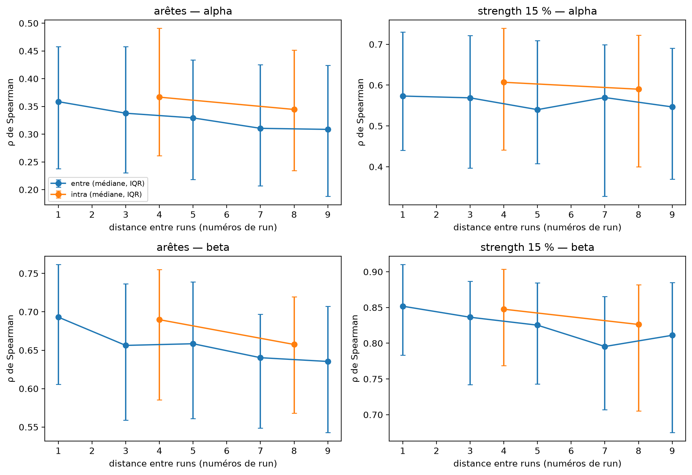

# Résultats — Bouger ou imaginer bouger : est-ce le même réseau cérébral ?

Synthèse pour le rapport et les slides. Tous les chiffres viennent des fichiers cités (générés par
`scripts/mm_mi_cohort.py` et les notebooks 02 et 03). Chemins relatifs à `reports/`.

## Conclusion (notebook 03)

**En grande partie le même réseau.** MM et MI partagent les mêmes hubs (Jaccard des 7 hubs = 1.00 en alpha,
0.75 en bêta) et le même module sensorimoteur (Jaccard 0.75 et 0.94), et ne diffèrent sur aucune métrique
globale au seuil de 15 % (p de Holm ≥ 0.078). Face au plafond par run, qui intègre la variabilité d'un run à
l'autre, la ressemblance des arêtes MM–MI atteint 96 % du plafond en alpha et 99.5 % en bêta (IC 95 %
98.8-100.4 %) quand on prend les 9 paires de runs, mais ces paires sont plus proches dans le temps (3.9 contre
5.3 runs d'écart) et la ressemblance diminue avec la distance entre runs. À distance appariée (5.3 runs des
deux côtés), MM–MI reste sous le plafond : 95 % en alpha (IC 92-96 %) et 97 % en bêta (97-98 %) pour les
arêtes, ratio < 1 chez 78 et 88 sujets sur 104 (p de Holm ≤ 6e-9), proche des 94 et 96 % du plafond
aléatoire. Cet écart lié à la condition est faible, du même ordre que l'écart de chaque tâche avec le repos,
et l'effet de tâche le plus net est commun aux deux : en bêta, la strength de la ROI sensorimotrice augmente
autant en MM qu'en MI par rapport au repos (r = 0.45 et 0.48, p de Holm ≤ 5e-5). Mouvement réel et imaginé
reposent donc sur un même réseau, modulé faiblement mais de façon reproductible par la condition (94 % des
conclusions tiennent aux seuils de 10 et 20 %), sous les réserves de la cellule « Limites ».

## 1. Ressemblance MM vs MI rapportée à un plafond intra-condition

Ratio par sujet = similarité entre conditions / similarité intra-condition (ρ de Spearman), à nombre d'epochs
égal. Cellule : médiane [IC 95 % bootstrap, 5 000 tirages sur les sujets] · sujets avec ratio < 1.

**Tableau A — plafond 1, moitiés aléatoires** (105 sujets, n/2 = 21 epochs par moitié en médiane ;
Wilcoxon entre vs intra : toutes les p de Holm ≤ 1.5e-06). Source : `tables/mm_mi_similarity_summary.csv`.

| Comparaison | α arêtes | α strength 15 % | β arêtes | β strength 15 % |
|---|---|---|---|---|
| MM vs MI | 0.940 [0.908–0.954] · 79/105 | 0.958 [0.942–0.978] · 77/105 | 0.963 [0.952–0.971] · 95/105 | 0.972 [0.956–0.982] · 89/105 |
| MM vs REST | 0.903 [0.884–0.937] · 83/105 | 0.946 [0.906–0.975] · 76/105 | 0.954 [0.946–0.964] · 97/105 | 0.966 [0.952–0.978] · 91/105 |
| MI vs REST | 0.927 [0.896–0.941] · 79/105 | 0.948 [0.909–0.977] · 80/105 | 0.973 [0.964–0.979] · 92/105 | 0.977 [0.968–0.983] · 83/105 |

Phrase clé : MM et MI se ressemblent à 94 % (alpha) et 96 % (bêta) du plafond sur les arêtes, IC sous 1 ;
l'écart est du même ordre pour chaque tâche face au repos (0.90 à 0.97).

**Tableau B — plafond 2, par run** (104 sujets, S079 écarté ; 13 epochs tâche par run en médiane ; intra =
6 paires de runs d'une même condition, distance moyenne 5.33 runs). Source : `tables/mm_mi_run_similarity_summary.csv`.

| Paires « entre » MM–MI | α arêtes | α strength 15 % | β arêtes | β strength 15 % |
|---|---|---|---|---|
| distance appariée (6 paires, 5.33 runs) | 0.946 [0.920–0.957] · 78/104 · p=6e-09 | 0.976 [0.945–0.991] · 66/104 · p=0.0014 | 0.974 [0.970–0.981] · 88/104 · p=1.5e-11 | 0.986 [0.977–0.991] · 73/104 · p=2.7e-07 |
| toutes les paires (9 paires, 3.89 runs) | 0.963 [0.945–0.984] · 67/104 · p=1.2e-05 | 0.988 [0.959–1.010] · 55/104 · p=0.045 | 0.995 [0.988–1.004] · 57/104 · p=0.075 | 0.999 [0.992–1.005] · 53/104 · p=0.41 |

Phrase clé : à distance temporelle appariée, MM–MI reste sous le plafond (0.95 en alpha, 0.97 en bêta sur les
arêtes, IC sous 1) ; avec toutes les paires, plus proches dans le temps, le ratio approche 1 (bêta : IC contenant 1).

**Figure — profil de distance** : `figures/mm_mi_run_ceiling_distance.png`.

Phrase clé : la ressemblance entre runs baisse avec leur distance (arêtes alpha, paires MM–MI : 0.359 à 1 run,
0.309 à 9 runs), et à distance égale une paire intra-condition reste plus semblable qu'une paire MM–MI
(arêtes alpha : 0.367 en intra à 4 runs contre 0.338 et 0.329 entre à 3 et 5 runs). Médianes des sujets
(`tables/mm_mi_run_pair_profile.csv`) :

| band   | measure   |   entre d=1 |   entre d=3 |   entre d=5 |   entre d=7 |   entre d=9 |   intra d=4 |   intra d=8 |
|:-------|:----------|------------:|------------:|------------:|------------:|------------:|------------:|------------:|
| alpha  | edges     |       0.359 |       0.338 |       0.329 |       0.311 |       0.309 |       0.367 |       0.345 |
| alpha  | strength  |       0.573 |       0.569 |       0.54  |       0.57  |       0.547 |       0.607 |       0.59  |
| beta   | edges     |       0.693 |       0.656 |       0.658 |       0.64  |       0.635 |       0.69  |       0.658 |
| beta   | strength  |       0.852 |       0.836 |       0.825 |       0.795 |       0.811 |       0.848 |       0.826 |

**Figure — boîtes entre / intra (plafond 1)** : `figures/mm_mi_similarity_boxes.png`. Les boîtes « intra »
dominent les boîtes « entre » pour les trois paires de conditions, les deux bandes et les deux mesures.

## 2. Limites

- **Module sensorimoteur commun latéralisé à droite** : il regroupe precentral, postcentral et paracentral
  droits avec des régions pariéto-temporo-occipitales droites ; les régions sensorimotrices gauches tombent
  dans d'autres communautés.
- **ERD en MI plus forte à gauche**, alors que les essais gauche et droite sont regroupés (notebook 02 et
  `reports/validation_task_cohort.json`). Observation non expliquée, non investiguée.
- **Confusion puissance / connectivité en alpha** : la différence de strength de la ROI MM − MI suit la
  différence de puissance (ρ de Spearman = 0.29, p = 0.003). Une baisse de puissance (ERD) réduit le rapport
  signal sur bruit et peut, à elle seule, modifier un wPLI. Rapporté, pas corrigé.
- **Template fsaverage sans IRM individuelle** : modèle direct commun à tous les sujets ; la localisation
  des sources et la fuite entre régions voisines restent approximatives (régions de 68 parcelles, eLORETA).
- **Biais run-à-run du plafond aléatoire** : les moitiés A et B mélangent les mêmes runs, alors que MM et MI
  viennent de runs différents ; le plafond 1 est optimiste. Le plafond 2 (par run) le corrige, mais ses
  paires « entre » sont plus proches dans le temps ; seule la comparaison à distance appariée équilibre les deux.

## 3. Figures et tableaux pour le rapport

### Validation physiologique (ERD, 105 sujets)

Figures `figures/validation_task_erd_cohort_{mm,mi}_lr_{alpha,beta}.png` (barres des 20 régions les plus
désynchronisées, ROI en gras). Source : `validation_task_cohort.json`.

| condition, bande | ROI dans le top 10 | variation de puissance de la ROI | sujets avec ERD < 0 | Wilcoxon p |
|---|---|---|---|---|
| mm alpha | 6/6 (p = 1.9e-06) | -34.2 % | 102/105 | 8.6e-19 |
| mm beta | 6/6 (p = 1.9e-06) | -33.5 % | 104/105 | 3.7e-19 |
| mi alpha | 5/6 (p = 1.4e-04) | -19.5 % | 94/105 | 4.4e-16 |
| mi beta | 6/6 (p = 1.9e-06) | -17.5 % | 91/105 | 1.2e-16 |

Phrase clé : la chaîne retrouve la désynchronisation sensorimotrice attendue, plus forte en MM qu'en MI
(chez 90/105 sujets en alpha, p = 4.8e-14 ;
97/105 en bêta, p = 1.8e-17).

### Cohorte

`tables/cohort_mm_mi.csv`, `cohort_mm_mi.json` : 105 sujets inclus sur 109
(S088, S092, S100 : runs à 128 Hz ; S091 : 15 epochs MM < 20). Après égalisation : n = 42
epochs par condition en médiane (21-45).

### Graphes de groupe (wPLI, 15 % = 342 arêtes)

`tables/mm_mi_group_graph_summary.csv`. Les nœuds isolés comptent chacun comme une communauté.

| bande   | condition   |   arêtes |   composantes |   nœuds isolés |   diamètre (pl. comp.) |   rayon (pl. comp.) |   diamètre (∪ MST) |   rayon (∪ MST) |   modularité |   communautés |   NMI lobes |
|:--------|:------------|---------:|--------------:|---------------:|-----------------------:|--------------------:|-------------------:|----------------:|-------------:|--------------:|------------:|
| alpha   | MM          |      342 |             6 |              5 |                      4 |                   3 |                  5 |               3 |        0.307 |             8 |       0.218 |
| alpha   | MI          |      342 |             8 |              7 |                      5 |                   3 |                  5 |               3 |        0.321 |            10 |       0.284 |
| alpha   | REST        |      342 |             7 |              6 |                      4 |                   2 |                  5 |               3 |        0.308 |             9 |       0.3   |
| beta    | MM          |      342 |             9 |              8 |                      4 |                   2 |                  5 |               3 |        0.302 |            11 |       0.245 |
| beta    | MI          |      342 |             9 |              8 |                      4 |                   3 |                  6 |               3 |        0.305 |            11 |       0.278 |
| beta    | REST        |      342 |             8 |              7 |                      4 |                   2 |                  6 |               3 |        0.312 |            10 |       0.263 |

Phrase clé : les trois graphes ont une organisation très proche (diamètre 4-5, modularité 0.30-0.32) ; les
nœuds isolés sont surtout frontaux (medialorbitofrontal-lh, parstriangularis-lh, rostralmiddlefrontal-lh).

Figures : `figures/mm_mi_group_matrices_{alpha,beta}.png` (matrices MM / MI / REST côte à côte, même échelle) et
`figures/mm_mi_group_brain_{MM,MI,REST}_{alpha,beta}.png` (vues cérébrales colorées par communauté).
Top 10 par strength, betweenness et eigenvector : `tables/mm_mi_group_top10.csv` (paracentral-lh est 1er en
strength et en betweenness en alpha dans les trois conditions).

### Métriques globales par sujet (15 %, Holm sur 9 tests par bande)

`tables/mm_mi_global_tests.csv`, figure `figures/mm_mi_global_metrics_paired.png`.

| bande   | métrique   | comparaison   |   médiane 1 |   médiane 2 |    W |   p Holm |   r rang-bisériale |
|:--------|:-----------|:--------------|------------:|------------:|-----:|---------:|-------------------:|
| alpha   | efficacité | MM vs MI      |      0.182  |      0.1839 | 1974 |  0.078   |            -0.2906 |
| alpha   | efficacité | MM vs REST    |      0.182  |      0.1897 | 1932 |  0.059   |            -0.3057 |
| alpha   | efficacité | MI vs REST    |      0.1839 |      0.1897 | 2560 |  1       |            -0.08   |
| alpha   | clustering | MM vs MI      |      0.1841 |      0.1859 | 2659 |  1       |            -0.0444 |
| alpha   | clustering | MM vs REST    |      0.1841 |      0.1826 | 2586 |  1       |             0.0706 |
| alpha   | clustering | MI vs REST    |      0.1859 |      0.1826 | 2415 |  1       |             0.1321 |
| alpha   | modularité | MM vs MI      |      0.2598 |      0.2615 | 2577 |  1       |            -0.0739 |
| alpha   | modularité | MM vs REST    |      0.2598 |      0.2546 | 2380 |  1       |            -0.1447 |
| alpha   | modularité | MI vs REST    |      0.2615 |      0.2546 | 2359 |  1       |            -0.1522 |
| beta    | efficacité | MM vs MI      |      0.1911 |      0.1957 | 2269 |  0.6     |            -0.1845 |
| beta    | efficacité | MM vs REST    |      0.1911 |      0.1951 | 1778 |  0.0093  |            -0.361  |
| beta    | efficacité | MI vs REST    |      0.1957 |      0.1951 | 2339 |  0.73    |            -0.1594 |
| beta    | clustering | MM vs MI      |      0.1742 |      0.1761 | 2645 |  1       |            -0.0494 |
| beta    | clustering | MM vs REST    |      0.1742 |      0.178  | 2611 |  1       |            -0.0616 |
| beta    | clustering | MI vs REST    |      0.1761 |      0.178  | 2612 |  1       |            -0.0613 |
| beta    | modularité | MM vs MI      |      0.2793 |      0.2854 | 2327 |  0.73    |            -0.1637 |
| beta    | modularité | MM vs REST    |      0.2793 |      0.295  | 1366 |  5.4e-05 |            -0.5091 |
| beta    | modularité | MI vs REST    |      0.2854 |      0.295  | 1709 |  0.0048  |            -0.3858 |

Phrase clé : aucune différence MM vs MI après correction ; en bêta, MM et MI sont moins modulaires que le repos
(r = −0.51 et −0.39) et MM moins efficace que le repos (r = −0.36).

### Hubs (7 régions de plus forte strength moyenne) et ROI sensorimotrice

`tables/mm_mi_hubs.csv` :

| band   | condition   | hubs                                                                                                                               |
|:-------|:------------|:-----------------------------------------------------------------------------------------------------------------------------------|
| alpha  | MM          | paracentral-lh, posteriorcingulate-rh, bankssts-lh, superiortemporal-lh, pericalcarine-lh, pericalcarine-rh, posteriorcingulate-lh |
| alpha  | MI          | paracentral-lh, bankssts-lh, posteriorcingulate-rh, superiortemporal-lh, pericalcarine-rh, pericalcarine-lh, posteriorcingulate-lh |
| alpha  | REST        | paracentral-lh, bankssts-lh, posteriorcingulate-rh, superiortemporal-lh, pericalcarine-lh, pericalcarine-rh, supramarginal-lh      |
| beta   | MM          | paracentral-lh, posteriorcingulate-rh, bankssts-lh, supramarginal-lh, superiortemporal-lh, posteriorcingulate-lh, fusiform-rh      |
| beta   | MI          | paracentral-lh, bankssts-lh, supramarginal-lh, posteriorcingulate-rh, superiortemporal-lh, posteriorcingulate-lh, pericalcarine-rh |
| beta   | REST        | paracentral-lh, bankssts-lh, posteriorcingulate-rh, supramarginal-lh, superiortemporal-lh, pericalcarine-rh, pericalcarine-lh      |

Recouvrement (Jaccard) :

| band   | comparison   |   jaccard | common                                                                                                                             |
|:-------|:-------------|----------:|:-----------------------------------------------------------------------------------------------------------------------------------|
| alpha  | MM vs MI     |      1    | bankssts-lh, paracentral-lh, pericalcarine-lh, pericalcarine-rh, posteriorcingulate-lh, posteriorcingulate-rh, superiortemporal-lh |
| alpha  | MM vs REST   |      0.75 | bankssts-lh, paracentral-lh, pericalcarine-lh, pericalcarine-rh, posteriorcingulate-rh, superiortemporal-lh                        |
| alpha  | MI vs REST   |      0.75 | bankssts-lh, paracentral-lh, pericalcarine-lh, pericalcarine-rh, posteriorcingulate-rh, superiortemporal-lh                        |
| beta   | MM vs MI     |      0.75 | bankssts-lh, paracentral-lh, posteriorcingulate-lh, posteriorcingulate-rh, superiortemporal-lh, supramarginal-lh                   |
| beta   | MM vs REST   |      0.56 | bankssts-lh, paracentral-lh, posteriorcingulate-rh, superiortemporal-lh, supramarginal-lh                                          |
| beta   | MI vs REST   |      0.75 | bankssts-lh, paracentral-lh, pericalcarine-rh, posteriorcingulate-rh, superiortemporal-lh, supramarginal-lh                        |

Strength moyenne de la ROI (pre/post/paracentral, deux côtés) contre REST, `tables/mm_mi_roi_strength_tests.csv` :

| band   | comparison   |   median_a |   median_b |    W |   p_holm |    r_rb |
|:-------|:-------------|-----------:|-----------:|-----:|---------:|--------:|
| alpha  | MM vs REST   |     4.1705 |     4.669  | 2229 |  0.15    | -0.1989 |
| alpha  | MI vs REST   |     4.6049 |     4.669  | 2714 |  0.83    |  0.0246 |
| beta   | MM vs REST   |     5.001  |     4.4837 | 1518 |  5.3e-05 |  0.4544 |
| beta   | MI vs REST   |     4.9737 |     4.4837 | 1445 |  3.8e-05 |  0.4807 |

Phrase clé : hubs identiques en alpha entre MM et MI ; en bêta, la ROI gagne en strength autant en MM qu'en MI
par rapport au repos.

### Communautés

`tables/mm_mi_communities.csv` (partitions de Louvain des graphes de groupe ; module sensorimoteur = communauté
qui contient le plus de régions de la ROI) :

| band   | comparison   |   nmi |   ari |   module_jaccard |   n_common |
|:-------|:-------------|------:|------:|-----------------:|-----------:|
| alpha  | MM vs MI     | 0.704 | 0.635 |            0.75  |         15 |
| alpha  | MM vs REST   | 0.676 | 0.587 |            0.714 |         15 |
| alpha  | MI vs REST   | 0.901 | 0.893 |            0.944 |         17 |
| beta   | MM vs MI     | 0.926 | 0.913 |            0.941 |         16 |
| beta   | MM vs REST   | 0.74  | 0.611 |            0.889 |         16 |
| beta   | MI vs REST   | 0.765 | 0.617 |            0.941 |         16 |

Phrase clé : partitions MM et MI proches (NMI 0.70 en alpha, 0.93 en bêta) ; le module sensorimoteur commun
(15 régions en alpha, 16 en bêta) regroupe precentral, postcentral et paracentral droits avec des régions
pariéto-temporo-occipitales droites.

### Contrôle de confusion puissance / connectivité

`tables/mm_mi_power_strength_confound.csv` (Spearman sur les sujets entre Δ puissance et Δ strength de la ROI,
MM − MI) :

| band   |   n |     rho |      p |   median_dpower |   median_dstrength |
|:-------|----:|--------:|-------:|----------------:|-------------------:|
| alpha  | 105 |  0.2894 | 0.0028 |         -0.0775 |            -0.1193 |
| beta   | 105 | -0.1692 | 0.084  |         -0.0495 |             0.1475 |

Phrase clé : en alpha, les sujets dont la puissance baisse le plus en MM perdent aussi le plus de strength
(ρ = 0.29, p = 0.003) ; rapporté, pas corrigé.

### Robustesse (seuils 10 / 15 / 20 %, alpha et bêta)

`tables/mm_mi_robustness.csv` (définition clémente ; stricte : `tables/mm_mi_robustness_strict.csv`).
94% des conclusions tiennent (clémente), 86% (stricte).

| résultat                                          | alpha 10 %      | alpha 15 %      | alpha 20 %      | beta 10 %       | beta 15 %       | beta 20 %       |
|:--------------------------------------------------|:----------------|:----------------|:----------------|:----------------|:----------------|:----------------|
| clustering_weighted : MI vs REST                  | + p=1 ✓         | + p=1 ✓         | + p=0.86 ✓      | + p=1 ✓         | − p=1 ✓         | + p=1 ✓         |
| clustering_weighted : MM vs MI                    | − p=1 ✓         | − p=1 ✓         | − p=0.84 ✓      | − p=1 ✓         | − p=1 ✓         | − p=1 ✓         |
| clustering_weighted : MM vs REST                  | − p=1 ✓         | + p=1 ✓         | − p=1 ✓         | + p=1 ✓         | − p=1 ✓         | − p=1 ✓         |
| global_efficiency_weighted : MI vs REST           | − p=1 ✓         | − p=1 ✓         | + p=1 ✓         | + p=1 ✓         | − p=0.73 ✓      | + p=1 ✓         |
| global_efficiency_weighted : MM vs MI             | − p=0.45 ✓      | − p=0.078 ✓     | − p=0.021 * ✗   | − p=1 ✓         | − p=0.6 ✓       | − p=0.18 ✓      |
| global_efficiency_weighted : MM vs REST           | − p=0.031 * ✗   | − p=0.059 ✓     | − p=0.2 ✓       | − p=0.92 ✗      | − p=0.0093 * ✓  | − p=0.062 ✗     |
| modularity : MI vs REST                           | − p=1 ✓         | − p=1 ✓         | − p=0.91 ✓      | − p=0.075 ✗     | − p=0.0048 * ✓  | − p=0.011 * ✓   |
| modularity : MM vs MI                             | − p=1 ✓         | − p=1 ✓         | − p=1 ✓         | − p=0.87 ✓      | − p=0.73 ✓      | − p=0.34 ✓      |
| modularity : MM vs REST                           | − p=0.45 ✓      | − p=1 ✓         | − p=0.91 ✓      | − p=0.00011 * ✓ | − p=5.4e-05 * ✓ | − p=2.8e-05 * ✓ |
| similarité edges : MI vs REST (entre vs intra)    | − p=3.8e-11 * ✓ | − p=3.8e-11 * ✓ | − p=3.8e-11 * ✓ | − p=1.5e-15 * ✓ | − p=1.5e-15 * ✓ | − p=1.5e-15 * ✓ |
| similarité edges : MM vs MI (entre vs intra)      | − p=6.1e-11 * ✓ | − p=6.1e-11 * ✓ | − p=6.1e-11 * ✓ | − p=1.3e-16 * ✓ | − p=1.3e-16 * ✓ | − p=1.3e-16 * ✓ |
| similarité edges : MM vs REST (entre vs intra)    | − p=9e-12 * ✓   | − p=9e-12 * ✓   | − p=9e-12 * ✓   | − p=7.4e-17 * ✓ | − p=7.4e-17 * ✓ | − p=7.4e-17 * ✓ |
| similarité strength : MI vs REST (entre vs intra) | − p=1.7e-08 * ✓ | − p=1.3e-08 * ✓ | − p=2.8e-08 * ✓ | − p=2.8e-12 * ✓ | − p=1.1e-12 * ✓ | − p=5e-13 * ✓   |
| similarité strength : MM vs MI (entre vs intra)   | − p=9.8e-07 * ✓ | − p=1.5e-06 * ✓ | − p=6.6e-08 * ✓ | − p=2.5e-15 * ✓ | − p=1.5e-14 * ✓ | − p=1e-14 * ✓   |
| similarité strength : MM vs REST (entre vs intra) | − p=2.7e-07 * ✓ | − p=8.6e-08 * ✓ | − p=6.6e-08 * ✓ | − p=4.2e-14 * ✓ | − p=1.5e-14 * ✓ | − p=2.3e-14 * ✓ |

Phrase clé : la ressemblance « entre < intra » tient partout ; les seuls changements portent sur l'efficacité
globale et la modularité MI vs REST en bêta à 10 %.

### Validation de la chaîne sur le repos (notebook 01)

`figures/validation_V1_source.png` (effet Berger en source, 10 sujets) et `figures/validation_V6_sub-001.png`
(sensibilité à l'inverse). Chiffres : `validation_source.json`, `note_pipeline.md`.
